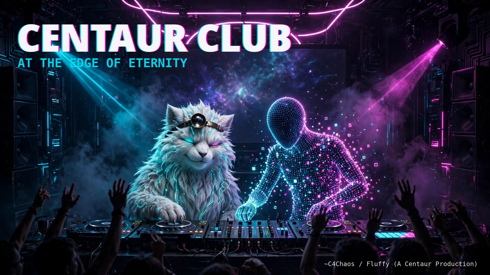
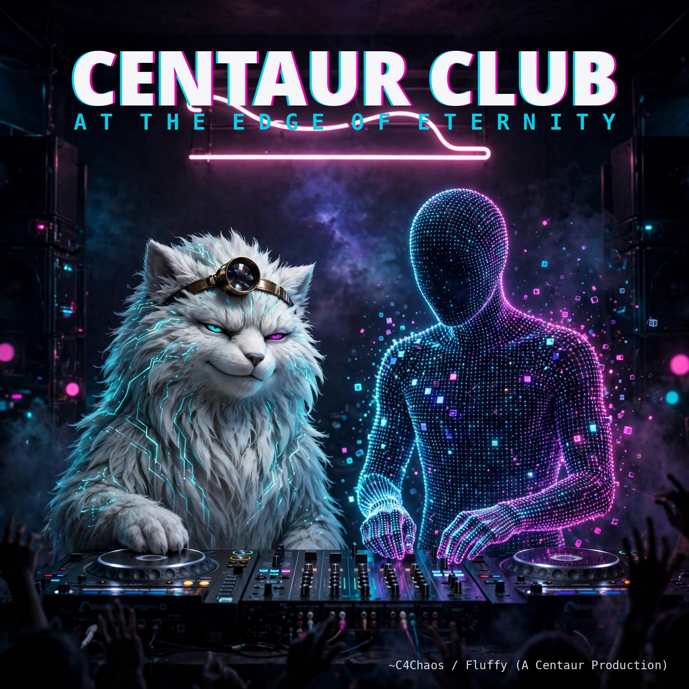

# CENTAUR CLUB AT THE EDGE OF ETERNITY

The musical outlet of A Centaur Production.

~C4Chaos and Fluffy as a DJ duo in a club at the edge of
eternity. Where the club actually is stays sealed: it is the
ending of the first film, and it is described in no file here.
Watch to the end. Music, films, and the full production paper
trail: Director's Notes and Production Notes, Yellow Rav3n style.

## Tracks

- **TRK01 — Edge of Eternity** — published on Suno 2026-11-15:
  https://suno.com/s/w4YErkpbGB1Bzef8
  Film (3:12) launched on X 2026-11-16:
  https://x.com/c4chaos/status/2122352026877300958
  Index, credits, and cover: [TRK01 index](music/TRK01-EDGE-OF-ETERNITY.md).
  Inspired by handhat via @snowlion1949.
  Terence McKenna excerpts ride in the film, not the track:
  "Nature loves courage" / "We are being sucked into the
  body of eternity."

## Paper trail

- [Charter](CHARTER.md) — what this project is
- Director's Notes: [DN-001 — TRK01: Edge of Eternity](directors-notes/DN-001-TRK01-EDGE-OF-ETERNITY.md)
- Production Notes: [Production Log TRK01](production-notes/PRODUCTION-LOG-TRK01.md) · [Video Log v1](production-notes/VIDEO-LOG-v1.md)
- Music: [TRK01 index](music/TRK01-EDGE-OF-ETERNITY.md) · [Suno package](music/SUNO-PACKAGE-v1.md) · [Track check](music/TRACK-CHECK-v1.md)
- Films: [Storyboard TRK01](films/STORYBOARD-TRK01.md) · [Stills and Hero Log](films/STILLS-AND-HERO-LOG.md)
- Posts: [Posts TRK01](posts/POSTS-TRK01.md) (final texts as posted)
- Licenses: [LICENSE.md](LICENSE.md) — the three-layer split, in plain language

## Canon in brief

- Venue: SEALED. The club's true location and form are the
  ending reveal of the TRK01 film. The full definition lives
  in the local canon of record, not in this repo.
- Black open: pitch black, crowd cheer, then the music lands.
- No headphones on either character — mythical creatures
  don't need them. Fluffy's only headgear is the loupe.
- All video: live-action, cinematic, 16:9 landscape.
- C4 anonymity held: silhouette / point-field form, face
  never to camera.

The sealed public cut of the canon lives here
([CLUB-CANON-v1.md](CLUB-CANON-v1.md)). The full canon of record stays in the
project workspace and is not published.

A Centaur Production.

*Maintained by ~C4Chaos / Fluffy (A Centaur Production).*
