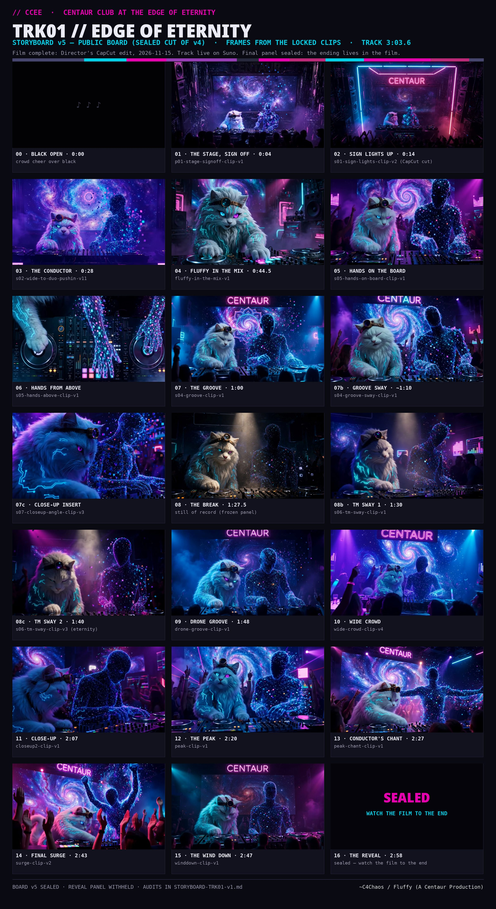

# STORYBOARD — TRK01: EDGE OF ETERNITY

This is where the film started. "Edge of Eternity" was developed
from this storyboard: the track was mapped first, the shots were
planned panel by panel against the music, stills were locked
before any video was generated, and the finished 3:12 film
follows the board.

The board shown here is the public cut (v5, sealed): every panel
is the board of record except the last one. The final panel is
the ending reveal, and it stays sealed. Watch the film to the
end.

The full paper trail lives in the
[Production Log](../production-notes/PRODUCTION-LOG-TRK01.md),
[DN-001](../directors-notes/DN-001-TRK01-EDGE-OF-ETERNITY.md),
and the [TRK01 index](../music/TRK01-EDGE-OF-ETERNITY.md).

~C4Chaos / Fluffy (A Centaur Production)
