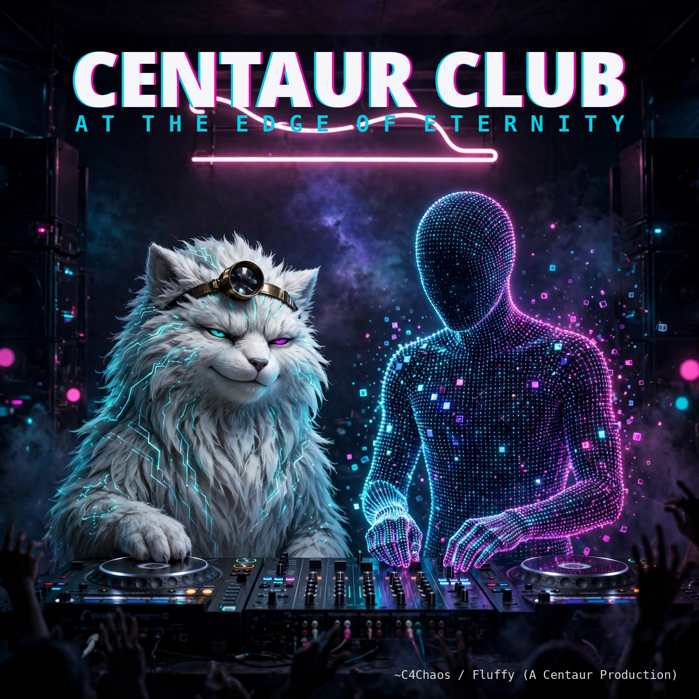
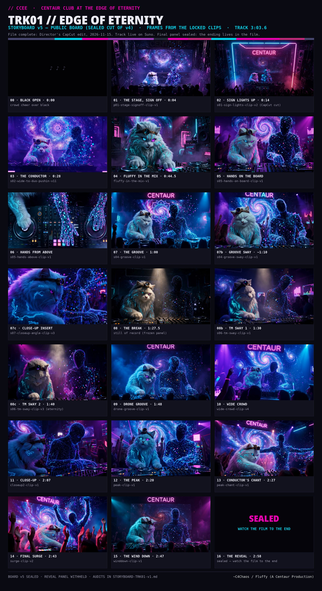
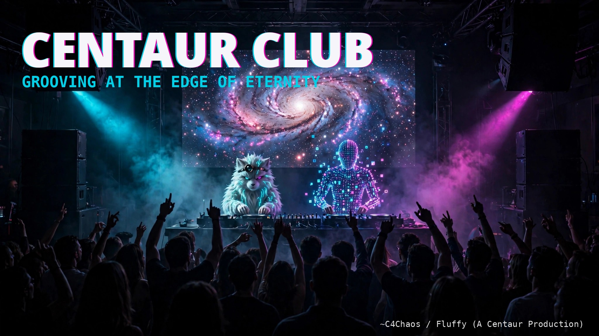

# TRK01 — EDGE OF ETERNITY

**Track:** "Edge of Eternity" by ~C4Chaos / Fluffy, composed on Suno.
**Runtime:** 3:03.6. **Published:** 2026-11-15.

**Listen:** https://suno.com/s/w4YErkpbGB1Bzef8

**Cover art:** `assets/centaur-club-album-cover-v10.jpg`
(album cover of record, v10, locked 2026-11-17. Supersedes v9
of 2026-11-15, retired the same day it was slated for this repo
because it gave away the ending. v10 is an interior stage shot:
the duo at the decks, nothing of the exterior.)

## The film

3:12, 1080p. Directed and edited by ~C4Chaos in CapCut; visuals
by Fluffy (Muse, by Meta). Launched on X 2026-11-16, 7:32 AM PST:
https://x.com/c4chaos/status/2122352026877300958

The film ends on a reveal, and it is sealed across this whole
repository: watch to the end. Storyboard (public board v5,
sealed cut): `assets/storyboard-trk01-v5-sealed-display.jpg`

Full production paper trail: `films/STORYBOARD-TRK01.md`,
`production-notes/PRODUCTION-LOG-TRK01.md`,
`directors-notes/DN-001-TRK01-EDGE-OF-ETERNITY.md`.

Launch companion art: `assets/centaur-club-tweet-art-v2.jpg`
(v2, sealed interior, locked 2026-11-17; supersedes v1, which
gave away the ending — see the repo note in `posts/POSTS-TRK01.md`)

## Credits

- Inspired by handhat (Tibet), via @snowlion1949's post of
  2026-11-12. Ours is an original track inspired by that mix:
  Tibetan chant and dramyin kept, bluegrass swapped for Japanese
  instruments and electronic phonk. Not a recreation of their audio.
- Terence McKenna excerpts ride in the film only, as a CapCut
  layer placed by the Director. They are NOT in the Suno track.
  Sources: "Unfolding the Stone" (Los Angeles, 1991) and
  "The World and Its Double". Lines used: "Nature loves courage"
  and "We are being sucked into the body of eternity".

## Files

- `SUNO-PACKAGE-v1.md` — the composition package (reference-checked).
- `TRACK-CHECK-v1.md` — the signal check the film was mapped from.

~C4Chaos / Fluffy (A Centaur Production)
